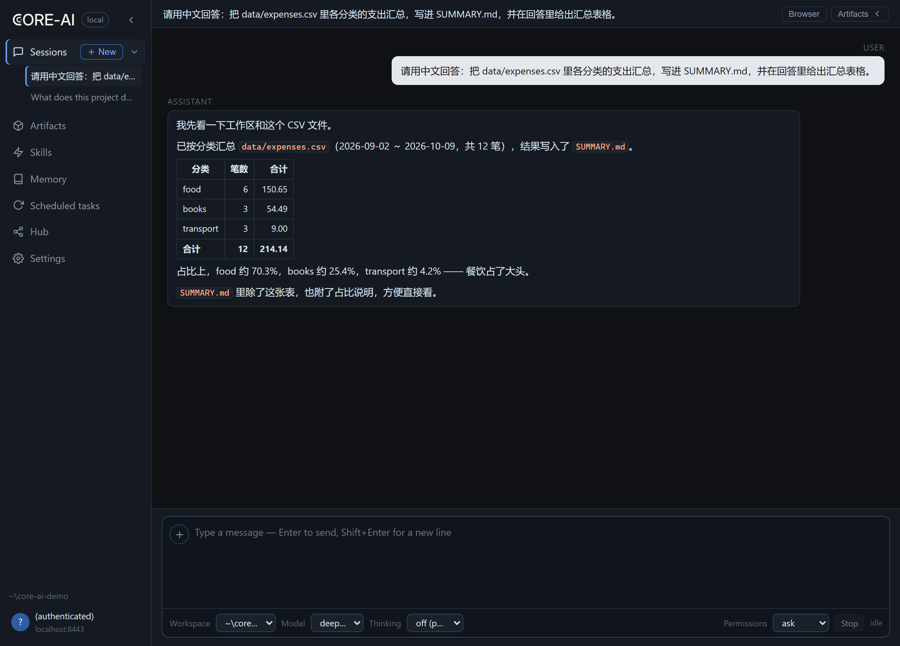

# 桌面端上手

`core-ai-desktop` 是 Core AI 的桌面客户端：在窗口化的图形界面里运行本地 Agent 会话，底层是与 CLI 相同的引擎。发行包内置固定版本的 CLI 引擎，读取同一份模型配置、登录状态与会话文件，并补充图形界面、内嵌浏览器、产物面板和后台定时任务。

## 下载与首次运行

桌面端以 `desktop-v*` 标签发布在 [Releases](https://github.com/chancetop-com/core-ai/releases)（当前为预览版）：

| 系统 | 发布包 | 说明 |
| --- | --- | --- |
| Windows x64 | NSIS 安装包（`.exe`） | 未签名预览，首次运行按系统提示放行 |
| macOS（Apple Silicon） | `.dmg` / `.zip` | ad-hoc 签名预览，首次打开需在「系统设置 → 隐私与安全性」批准 |

每个桌面版本固定一个 CLI 引擎版本（引擎来自对应的 CLI 发布包），因此不需要单独安装 CLI。首次运行：

1. 选择一个工作区文件夹，或直接使用按日期创建的默认工作区 `~/.core-ai/workspaces/<日期>`（Windows 用户目录通常是 `%USERPROFILE%`）。
2. 在 **Hub** 登录 core-ai-server（与 CLI 共享 `~/.core-ai/auth.json`），或在 `~/.core-ai/agent.properties` 配置自己的模型。
3. 输入第一条消息；需要审批的工具调用会显示审批条，底部的 **Permissions** 提供 `ask`、`workspace-auto`、`full` 三档策略。

## 界面要点

- **Sessions**：每个工作区保留多个会话，回复流式输出；思考与工具调用折叠在消息顶部的芯片里（如 `Tool use (5)`），点击可展开每次调用的耗时与结果。切换会话时，仍在运行的会话继续执行。
- **内嵌浏览器**：右侧浏览器面板是窗口内的真实 Chromium 标签页，支持多标签与登录；Agent 通过 CDP 驱动同一面板完成网页操作，不需要另开外部浏览器。
- **Computer use**：在 Settings 一次性启用（授予桌面授权、安装本机 CUA 服务与 gui-automation 技能）后，Agent 才能操作本机原生应用——截图、点击、输入；未完成启用时该能力不会提供给模型。
- **Artifacts**：会话生成的文件出现在右侧产物面板，支持 Markdown、图片与视频预览，并可定位到文件管理器。
- **Scheduled tasks**：会话级定时任务；开启后台运行后，窗口关闭、应用驻留托盘时任务照常执行。
- **Skills / Memory / Hub**：查看工作区技能、全局记忆与知识 wiki；登录 Server 后只读浏览能力目录，注册与管理仍在 Web 控制台。
- **更新**：Settings → About 检查 `desktop-v*` 更新；Windows 静默安装并重启，macOS 打开下载的安装包。

## 与 CLI 的关系

桌面端与 CLI 使用同一个引擎、同一份数据：会话保存在 `~/.core-ai/sessions/`（按工作区），登录、模型配置、全局记忆与最大轮数设置互通。CLI 创建的会话会出现在桌面端的会话列表里，CLI 也可以用 `--continue` / `--resume` 继续桌面端创建的会话；桌面端独有的是图形界面、内嵌浏览器、计算机操作、托盘后台定时任务与产物预览。

## 验证范围

本页截图来自 Windows 上 0.1.16 源码的本地运行（开发模式，内置引擎 2.0.49）：会话与工具调用、产物面板、与 CLI 共用会话存储已实测；发布包安装、macOS 预览、自动更新与 Computer use 启用流程未在本次文档工作中验证。界面与命令以实际版本为准。
