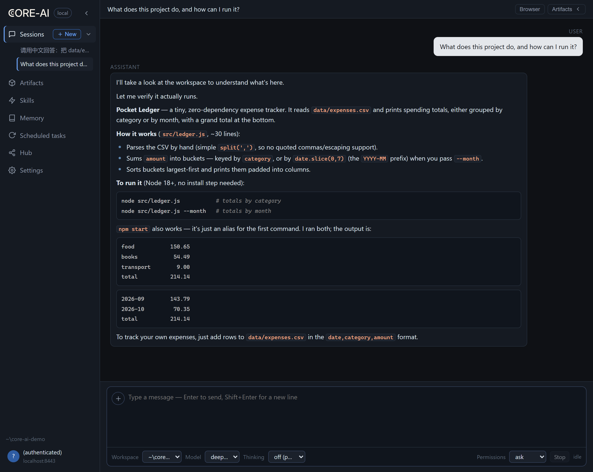
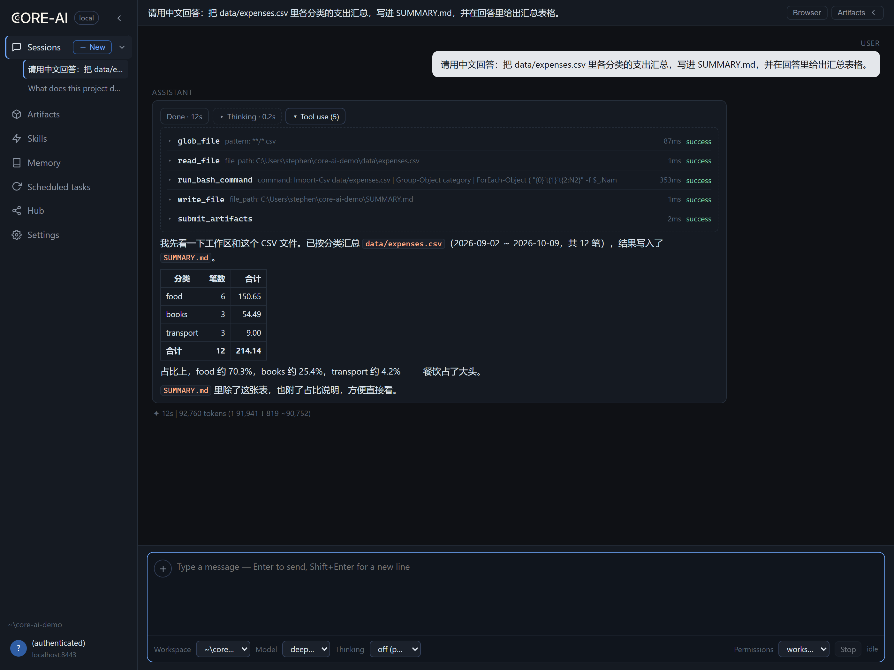
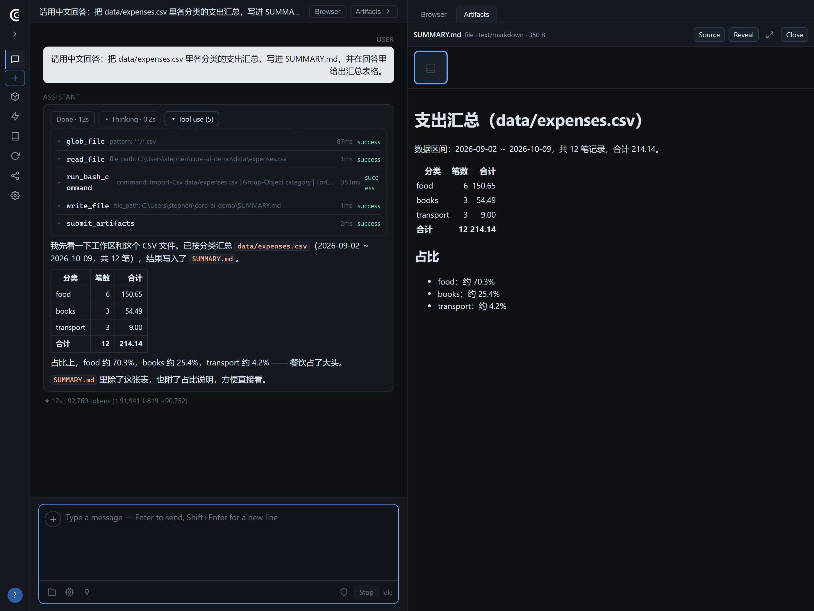

# Desktop Guide

`core-ai-desktop` is the Core AI desktop client: local agent sessions in a GUI window, backed by the same engine as the CLI. Packages bundle a pinned CLI engine, read the same model configuration, sign-in state and session files, and add a window, an embedded browser, an artifacts dock and background scheduled tasks.

## Download and first run

Desktop previews are published on the [Releases](https://github.com/chancetop-com/core-ai/releases) page under `desktop-v*` tags:

| OS | Package | Notes |
| --- | --- | --- |
| Windows x64 | NSIS installer (`.exe`) | unsigned preview; approve it on first run when your system asks |
| macOS (Apple Silicon) | `.dmg` / `.zip` | ad-hoc signed preview; approve it once in System Settings > Privacy & Security |

Each desktop version pins one CLI engine version (the engine ships with the matching CLI release), so a separate CLI install is not required. First run:

1. Pick a workspace folder, or use the dated default workspace `~/.core-ai/workspaces/<date>` (`%USERPROFILE%` on Windows).
2. Sign in to core-ai-server from the **Hub** (it shares `~/.core-ai/auth.json` with the CLI), or configure your own model in `~/.core-ai/agent.properties`.
3. Send the first message. Tool calls that need approval show an approval bar; the **Permissions** control at the bottom offers the `ask`, `workspace-auto` and `full` policies.

## What the window offers

- **Sessions**: multiple conversations per workspace, streaming replies, and thinking / tool calls collapsed into chips at the top of a message (for example `Tool use (5)`) that expand into each call's duration and result. Sessions that are still working keep running when you switch away.
- **Embedded browser**: the right-hand browser pane is real Chromium inside the window — multiple tabs, sign-in capable; agents drive the same pane over CDP, so no external browser is needed.
- **Computer use**: once enabled under Settings (desktop consent, a local CUA service and the gui-automation skill), agents can operate native apps — screenshots, clicks, typing. Until it is enabled, the capability is not offered to the model.
- **Artifacts**: files a session generates appear in the right-hand dock with Markdown, image and video previews, plus reveal-in-file-manager.
- **Scheduled tasks**: session-bound tasks; with background running enabled they still execute when the window is closed and the app stays in the tray.
- **Skills / Memory / Hub**: built-in `core-ai-cli-manual`, `browser-use`, `gui-automation` and `ocg` skills are installed under `~/.core-ai/skills` on first launch and work without a server login; after signing in, Hub adds read-only server capability discovery (registration and management stay in the web console).
- **Updates**: Settings → About checks the `desktop-v*` stream; Windows installs silently and relaunches, macOS opens the downloaded package.

## Relationship to the CLI

The desktop app and the CLI share one engine and one data store: sessions live in `~/.core-ai/sessions/` (per workspace), and sign-in, model configuration, global memory and max-turns settings are common to both. Sessions created in the CLI show up in the desktop session list, and the CLI can continue desktop sessions with `--continue` / `--resume`. What the desktop adds: the GUI, the embedded browser pane, computer use, tray background scheduling and artifact previews.

## Validation scope

The screenshots on this page come from a local Windows run of the 0.1.16 source (development mode, pinned engine 2.0.49): sessions and tool calls, the artifacts dock and the shared session store were exercised; release-package installation, macOS previews, auto-updates and the computer-use enablement flow were not verified in this documentation task. Expect the interface to follow the actual release.
