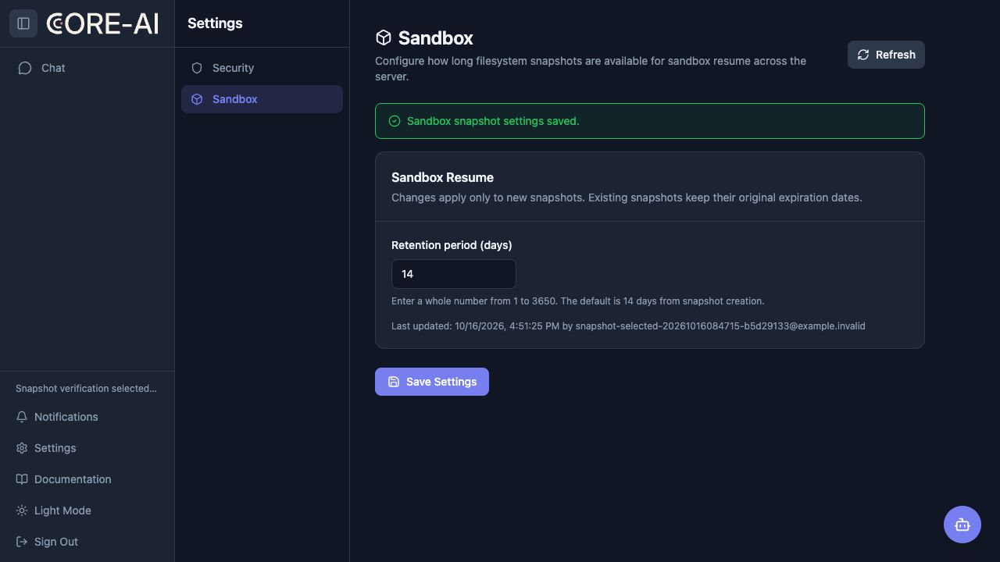

# Sandbox 快照保留天数：dev 部署验证

2026-10-16 验证通过。权限码为 `sandbox.snapshot.manage`，页面为 [Settings → Sandbox](https://core-ai-server.connexup-dev.net/settings/sandbox)。dev 最终恢复为默认 **14 天**。

## 部署与运行状态

- 环境：`FBRDevAKSCluster / dev-ai / core-ai-server`。此次只部署 dev。
- 镜像：`chancetop/core-ai-server:dev-snapshot-retention-20261016-01`。
- Registry 与两个运行实例的镜像摘要一致：`sha256:6fdea5f71884223c590d70d240cc9f99a1e6146dededa7bfe63b7180cf109190`。
- 源码为本地工作区构建：HEAD `5ef35e5e44ccd88d9a755fa248d04dbdad48fb93`，构建时 `git diff HEAD` SHA-256 为 `f48a47a9e325699e91c96520419c07ba065f443c95deec9bfb16cca344a78524`；未提交或推送 Git。
- 最终检查时间：2026-10-16T08:56:08.005327+00:00；deployment generation / observed generation 均为 587，2/2 Ready。
- `/`、`/settings/sandbox`、`/api/capabilities`、已认证 `/api/auth/me`、`/api/admin/system-settings`、`/api/settings/sandbox-snapshot` 均返回 200。

| 实例 | 容器启动时间（UTC） | 重启次数 | 最终状态 |
| --- | --- | --- | --- |
| `core-ai-server-56985d96d6-2jqzt` | 2026-10-16T08:46:10Z | 0 | Ready |
| `core-ai-server-56985d96d6-wzn2j` | 2026-10-16T08:45:44Z | 0 | Ready |

配置与快照测试在 08:49:50–08:50:32 UTC 执行；测试前后实例名称相同，最终容器启动时间早于测试，重启次数为 0。配置变更期间没有重启实例。

## 权限控制

所有身份均先通过身份接口确认，测试角色与账号由本次验证创建，验证后已移除。

| 身份 | GET 配置 | PUT 配置 |
| --- | --- | --- |
| 管理员（`*`） | 200 | 200 |
| 指定非管理员（`sandbox.snapshot.manage`，另有 `chat.use` 用于快照测试） | 200 | 200 |
| 普通用户（仅 `chat.use`） | 403 | 403 |
| 仅 `system.manage` 用户 | 403 | 403 |
| 真实 API 调用账号（有效 `ctk`，身份接口 200） | 403 | 403 |
| 未登录 | 401 | 401 |

指定用户访问旧 `/api/admin/system-settings` 的 GET/PUT 仍为 403，授予新权限未扩大为系统管理权限。

网页验证：授权账号可见 Sandbox 入口，保存 21 天后独立 API GET 返回 21；无权限账号不显示入口，直接访问配置页跳转 `/for-you`，无法编辑。网页拒绝小数输入。API 允许边界 1、3650；0、3651、1.5、3650.5、高精度小数 1.0000000000000000001、缺失字段和 null 均返回 400，原值不变。

## 真实快照验证

分别创建两个新会话。每个会话实际调用 `run_bash_command` 在 `/workspace` 写入唯一标记并 `cat` 读回，工具成功且会话 idle 后关闭运行时，等待快照状态成为 AVAILABLE，再读取 Mongo 持久化元数据。

| 配置值 | 快照 ID | 创建时间（UTC） | 到期时间（UTC） | 状态 |
| --- | --- | --- | --- | --- |
| 21 天 | `1f15f8b0-9d16-4ce7-be20-f4283fac20a1` | 2026-10-16T08:50:00.842Z | 2026-11-06T08:50:00.842Z | AVAILABLE |
| 7 天 | `cf340181-6f3e-44c9-bda9-e9f59b203a7b` | 2026-10-16T08:50:22.399Z | 2026-10-23T08:50:22.399Z | AVAILABLE |

两次 `expires_at - created_at` 精确等于 21 天（1,814,400,000 ms）和 7 天（604,800,000 ms），均有 1 个文件及非空快照内容。改为 7 天后，以及第二份快照生成后，第一份快照的 ID、创建时间和到期时间均未改变。

本次证明新配置参与真实快照的到期时间计算与持久化；没有等待自然到期，也未额外执行快照恢复测试。

## 恢复与清理

- 网页先恢复 14 天并独立 GET 确认；随后按本次创建人与最后更新人、14 天值和精确更新时间做条件删除，恢复测试前不存在的独立配置记录。最终 GET 为 `retention_days: 14`，`updated_by/updated_at: null`。
- 4 个测试账号、3 个测试角色与 2 个 API key 记录已删除并回读。临时凭据访问身份接口返回 401；原 `rbac_roles` 字段已精确恢复。
- 2 个会话、2 个快照、2 个 epoch、4 条消息、2 个 trace、8 个 span 已清理，最终独立查询均为 0。
- 快照通过应用删除接口清理，随后确认 Mongo 快照元数据不存在。应用仅在 Blob 删除成功后移除元数据；本次没有另行直接读取对象存储确认。
- 原系统布尔配置与快照开关保持一致；快照 enabled、deployment allowed、storage ready、effective 均仍为 true。

## 原始验证证据

以下文件已检查不含本次测试密码或 API key：

- [部署与接口回读](assets/sandbox-snapshot-dev-20261016/evidence/deployment-evidence.json)
- [测试前后实例状态](assets/sandbox-snapshot-dev-20261016/evidence/runtime-stability-evidence.json)
- [权限矩阵与参数验证](assets/sandbox-snapshot-dev-20261016/evidence/permission-evidence.json)
- [网页保存与接口回读](assets/sandbox-snapshot-dev-20261016/evidence/ui-evidence.json)
- [真实快照与旧快照对比](assets/sandbox-snapshot-dev-20261016/evidence/snapshots-evidence.json)
- [会话与快照清理](assets/sandbox-snapshot-dev-20261016/evidence/cleanup-evidence.json)
- [角色、凭据与配置最终恢复](assets/sandbox-snapshot-dev-20261016/evidence/final-cleanup-evidence.json)
